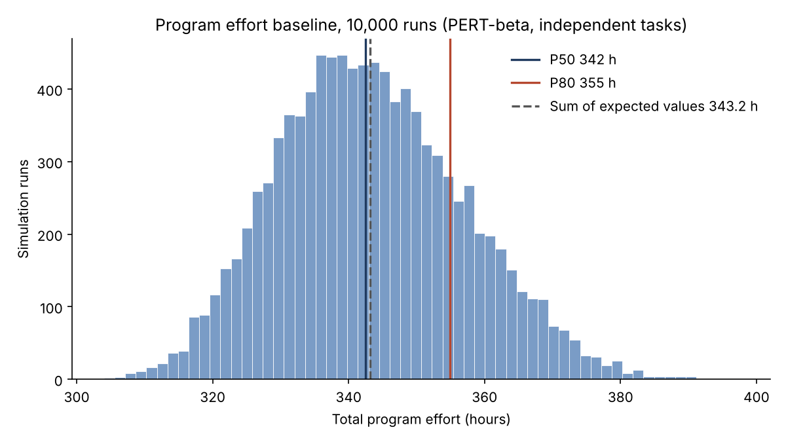

# Monte Carlo Baseline: Program Effort

**Generated by:** `scripts/monte_carlo_baseline.py`
**Inputs:** `pm-baselines/wbs.md`, 83 work packages, three-point estimates in hours
**Status:** Baseline. Produced before pathfinder replication begins. Not edited afterwards.

## Assumptions

- **Distribution:** PERT-beta (shape parameter 4) for each work package. A triangular distribution is run as a sensitivity check.
- **Iterations:** 10,000. Fixed random seed (20261105), so the run can be reproduced exactly.
- **Independence:** work packages are treated as statistically independent. No correlation between packages is modelled.
- **Quantity simulated:** total effort in hours, the sum of all work packages. It is not a calendar duration.
- **Conversion to weeks:** divided by 35 hours per week, the figure stated in the WBS summary.
- **Inputs are the original baseline estimates.** Nothing is adjusted for work already done.

## Results

| Measure | PERT-beta (primary) | Triangular (check) |
|---|---|---|
| Sum of expected values (deterministic) | 343.2 h | 343.2 h |
| Mean | 343.2 h | 368.2 h |
| P10 | 326.1 h | 347.9 h |
| **P50** | **342.4 h** (9.8 weeks) | 367.2 h (10.5 weeks) |
| **P80** | **354.9 h** (10.1 weeks) | 382.6 h (10.9 weeks) |
| P90 | 361.7 h | 390.2 h |
| Standard deviation | 13.7 h | 16.2 h |

### By WBS section (PERT-beta)

| Section | Packages | Sum of expected (h) | P50 (h) | P80 (h) |
|---|---|---|---|---|
| 1.0 | 11 | 37.5 | 37.5 | 39.5 |
| 2.0 | 8 | 33.5 | 33.4 | 35.4 |
| 3.0 | 14 | 50.3 | 50.2 | 53.2 |
| 4.0 | 18 | 83.7 | 82.8 | 94.1 |
| 5.0 | 9 | 26.2 | 26.1 | 28.1 |
| 6.0 | 8 | 28.7 | 28.6 | 30.6 |
| 7.0 | 5 | 32.0 | 31.9 | 33.8 |
| 8.0 | 10 | 51.3 | 51.2 | 54.2 |

## Limitations

- **Independence understates the spread.** Real delays tend to be correlated: a bad week affects many packages at once. Treating packages as independent makes the total distribution narrower than it probably is, so the P80 here is likely optimistic.
- **Effort is not duration.** Package 4.2.2 (initial synchronization) is elapsed waiting time and sits on the critical path. Summing effort does not capture waiting or the order of work. A schedule simulation along the dependency path would be needed for that.
- **The estimates are the author's own judgment.** The simulation spreads them out, but it cannot correct a bias in them. If every estimate is low, so is every percentile.
- **Pessimistic values are not hard limits.** The distributions are bounded by O and P. A real overrun beyond P cannot appear here.
- **One operator, one project.** The result describes this plan, not migration programs in general.

## How this is used

After the pathfinder, the same script is run again with measured values in place of the planning estimates for the pathfinder packages. The change in P50 and P80 is reported in Chapter 5.
